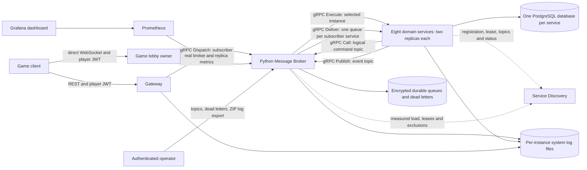
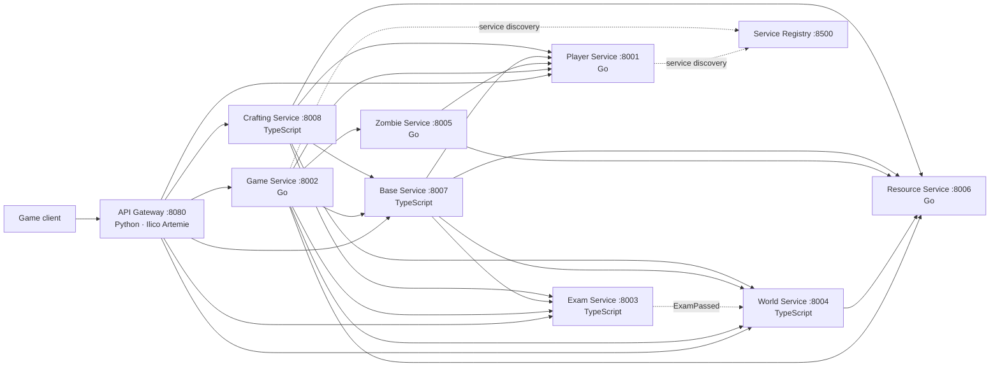

# Lab 4 architecture

The public API remains REST for game clients. Gateway verifies player JWTs and
sends user operations to the Python Message Broker over gRPC. Internal service
commands and events use the broker directly; they cannot pass through the Lab 4
Gateway. Each of the eight domain services has two native gRPC workers backed by
its existing shared service database.

The gRPC definition is `message-broker/proto/broker.proto`. Checked-in Go bindings
and Node/Python worker contracts use that same schema. An `Execute` call invokes
existing service handlers **in process**; there is no REST loopback between the
broker and a worker. The business JSON schemas remain versioned inside protobuf
payloads. HTTP health probes, Discovery management and JWKS are control-plane
operations, separate from business communication.

| Component | Responsibility |
| --- | --- |
| Gateway | User route allowlist, verified player identity, body/time limits, subscriber dispatch |
| Broker | Durable acceptance, event fan-out, delivery leases/retries, measured-load selection, physical-attempt circuits, failover, operational API |
| Discovery | Instance identities, native gRPC endpoints, topic subscriptions, expiring leases, health/load observations and persistent removal |
| Domain workers | Existing authenticated business rules and transactional deduplication; native gRPC transport |
| Prometheus/Grafana | Delivery throughput/latency, retry/circuit rates, queue/dead-letter counts, replica load and eligibility |

`commands.player`, `commands.game`, `commands.exam`, `commands.world`,
`commands.zombie`, `commands.resource`, `commands.base` and `commands.crafting`
are logical request/reply topics. A command topic has one subscriber **service
group**, which may contain multiple replicas. `events.ExamPassed`, for example,
is published once; the broker resolves interested service groups and persists an
independent delivery for each. A failed subscriber does not discard another
subscriber's delivery.

Producer outboxes commit outgoing events with the source business transaction.
Broker receipts acknowledge durable acceptance, not completion by every consumer.
Delivery is at least once: event IDs and command idempotency keys must be enforced
inside each consumer's business transaction. Unkeyed mutations are not blindly
retried after ambiguous downstream failures. Game's persisted lobby/WebSocket
ownership is preserved; a missing owner does not cause unsafe automatic ownership
transfer. Clients reconnect using the negotiation endpoint after recovery.

Existing Gateway-prefixed dependency paths are interpreted as logical topic
addresses by the native adapters in Lab 4. The Lab 4 deployment points them at
`http://message-broker:8600/<service-name>`; the adapters use gRPC on that target
and never make a business HTTP request to that address. This preserves existing
caller payloads and URL path contracts during the migration.

All four developers retain their two domain image repositories. Gateway remains
`artflow/gateway`, Discovery remains `geografix/service-discovery`, and the only
new image repository is `unstoppabledestroyer/message-broker`. Release tags are
immutable; `latest` is an alias of the reviewed release. Historical Lab 1?3 tags
are retained for reproducibility.

Lab 4 runs with `deploy/docker-compose.lab4.yml`; use its build override while
implementing unreleased source. The published-only configuration becomes usable
when all referenced `4.0.0` images have been released. Lab 3 retains its separate
configuration, image tags and persistent volumes.

---

# Previous Lab 2 architecture

The CPR is the public contract repository. Lab 2 adds the Python Gateway as the ninth service and
the only client-facing REST entry point. Each domain service owns its private database; services
communicate through versioned HTTP APIs and selected domain events. The Gateway validates
authorization, routes REST traffic, negotiates direct WebSocket connections, and enforces limits.

## Runtime rules

- Every service owns its own PostgreSQL database; no service reads another service's tables.
- REST uses `/api/v1/`; WebSocket sessions use `/ws/v1/`.
- Player Service issues RS256 player tokens. Other services validate them using Player JWKS.
- Cross-service writes use service tokens and an `Idempotency-Key`.
- `ExamPassed` is the event that unlocks new World wings.
- Game owns timers and orchestration, but not map, inventory, resource, or zombie truth.

See the [full communication contract](../README.md#communication-contract) for payloads,
responses, errors, and data models.
