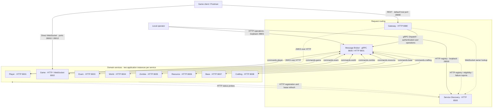
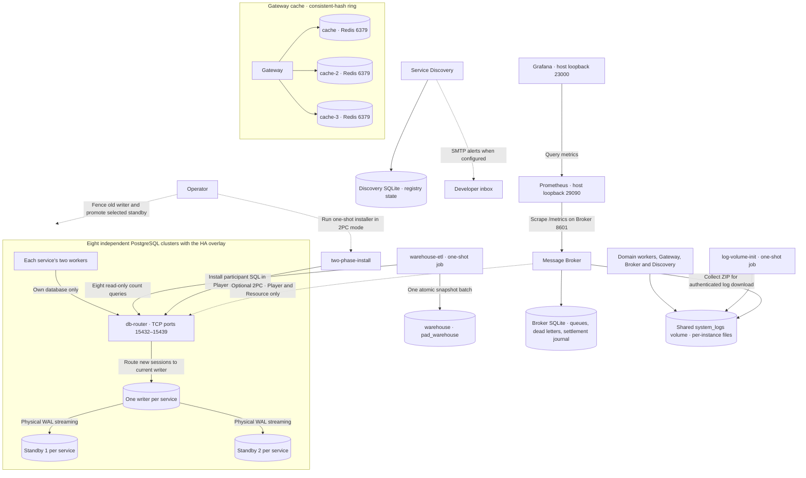
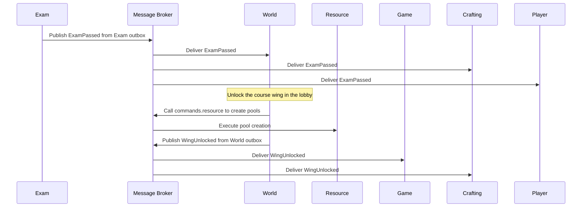
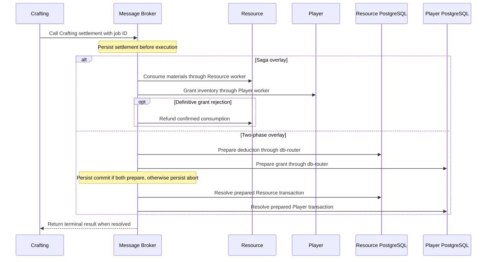

# Lab 5 architecture

The released stack layers [Lab 5 Compose overlays](../README.md#lab-5-warehouse-and-etl) over [the Lab 4 runtime](../deploy/docker-compose.lab4.yml). The diagrams show the release with caching, database high availability, analytics and Broker settlement enabled. The two-phase commit overlay selects the settlement protocol for new crafts.

## Runtime topology

Each worker link represents the shared gRPC contract in [`broker.proto`](../contracts/broker/v1/broker.proto). Workers make request/reply calls with `Call` and publish events with `Publish`. Broker invokes worker handlers with `Execute` and delivers subscriber events with `Deliver`. The port shown inside each worker is its HTTP listener. Each worker registered a private gRPC listener on port `9000` in the published deployment. The host exposes Game's two HTTP ports for direct WebSocket sessions. Broker's gRPC port is available on host loopback `28600` for development and demos.

| Service | Owns | PostgreSQL database | Router port with HA |
| --- | --- | --- | --- |
| Player | Accounts, player tokens and signing keys, inventory, XP, friends and presence | `player_db` | 15432 |
| Game | Lobbies, action timers, trades and WebSocket stream ownership | `game_db` | 15433 |
| Exam | Course enrolment, exam attempts, grades and achievements | `exam_db` | 15434 |
| World | Lobby maps, rooms, corridors and wing unlock state | `world_db` | 15435 |
| Zombie | Zombie catalogue and lobby-scoped zombie instances | `zombie_db` | 15436 |
| Resource | Lobby balances, stock pools and resource transaction ledger | `resource_db` | 15437 |
| Base | Lobby base, facilities, barricades and Kiki state | `base_db` | 15438 |
| Crafting | Recipe catalogue, craft jobs and their outbox | `crafting_db` | 15439 |

## Storage, cache and operations

Gateway caches selected authenticated catalogue GETs for 30 seconds and Player public signing keys for 60 seconds. A cache miss goes to the original source. A shard failure falls back to the original source for its keys. The Redis nodes are standalone and the ring lives in Gateway.

The [HA overlay](../deploy/docker-compose.lab5-ha.yml) supplies each service with its own writer route. The two standbys replicate asynchronously. Failover is operator-led, and the old writer must be fenced before promotion. The [ETL job](../deploy/warehouse/extract.sh) reads one table count per service and writes eight aggregate rows in one warehouse transaction. Source reads are independent. With the base analytics overlay alone, ETL connects directly to each service database. With HA, it connects through the router.

## Example event flow

These subscriptions come from the worker registrations in the published stack,
as returned by Discovery `GET /v1/instances`.

| Service | Registered event topics, excluding the `events.` prefix |
| --- | --- |
| Player | `AchievementUnlocked`, `ExamPassed`, `ItemCrafted`, `ZombieKilled` |
| Game | `WingUnlocked` |
| Exam | `PlayerRegistered` |
| World | `ExamPassed`, `LobbyCreated` |
| Zombie | `CycleChanged`, `LobbyFinished` |
| Resource | `LobbyFinished` |
| Base | `LobbyCreated`, `LobbyFinished` |
| Crafting | `ExamPassed`, `PlayerLeveledUp`, `WingUnlocked` |

The two World outbox outputs are independently dispatched. The drawing shows their relationship to the wing unlock. Broker queues events per subscriber service and may retry delivery. Consumers use event IDs to deduplicate.

## Crafting settlement

The saga retries ambiguous outcomes using stable step keys. Two-phase commit uses the restricted functions installed by `two-phase-install` and the Broker journal to resume a durable decision after interruption. An unfinished craft can return HTTP 202 and is readable by job ID. The [Postman walkthrough](../postman/README.md) correlates the job with Broker's operator view.

## Implementation references

- [Base deployment](../deploy/docker-compose.lab4.yml), [analytics](../deploy/docker-compose.lab5.yml), [replication](../deploy/docker-compose.lab5-ha.yml), [cache](../deploy/docker-compose.lab5-cache.yml) and [published images](../deploy/docker-compose.lab5-release.yml).
- [Saga configuration](../deploy/docker-compose.lab5-sagas.yml), [two-phase configuration](../deploy/docker-compose.lab5-2pc.yml), [participant SQL](../deploy/two-phase) and [monitoring configuration](../deploy/monitoring).
- [Public routes, payloads and errors](../README.md#communication-contract) and [native gRPC examples](../postman/grpc/README.md).

## Repository responsibility

Player/Game, Zombie/Resource, Base/Crafting and Exam/World are the assigned
private repositories. Gateway, Discovery and Broker are shared. See the
[repository access and review policy](../README.md#protection-rules) for ownership and release rules.
