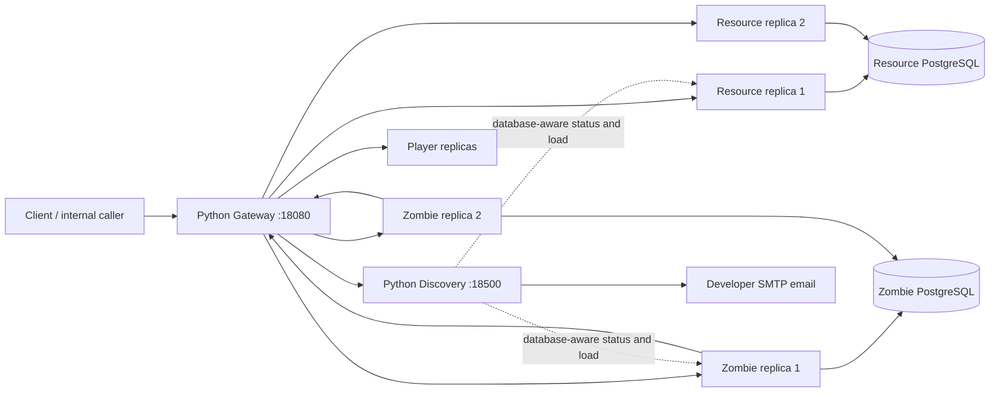

# Maxim Roenco — Lab 3 presentation guide

Maxim owns **Zombie Service** and **Resource Service**. Both now run as two independently
registered Go replicas, alongside Islam's Player and Game services and the shared Python
Gateway/Discovery. Use this guide together with [the shared guide](lab3-mentor-guide.md).

## Opening explanation

> “My services now register themselves with Service Discovery at startup and renew their leases.
> The Gateway distributes requests across two replicas of each service. Their state and
> idempotency records live in each service's own PostgreSQL database, so a request can move to
> another replica safely. Discovery monitors readiness and load, sends developer email alerts,
> and removes an instance after three failures inside task timeout times 3.5.”

The important extra correctness work is in Zombie. A kill includes external Player calls before
the local death commit. Two replicas could otherwise both award loot. PostgreSQL advisory locks
now serialize **the entire operation on the same zombie**, including its external calls.
Steal, damage, kill, explicit despawn and event-driven cleanup coordinate on the same lock.
Unrelated zombies can still progress concurrently.



## Rubric mapping

| Grade | Evidence for Maxim's part |
| --- | --- |
| 2–4 | Shared private Python Discovery repository, professor/team access, README, CI, registration endpoint and published image already established by the shared Lab 3 work |
| 3 | Both services expose `/api/v1/status` with readiness, instance ID, in-flight count, capacity and load; JSON logs include method/path/status/latency/request ID |
| 5 | Compose runs two Zombie and two Resource replicas; hostname-based identities and renewable leases support dynamic scale up/down |
| 6 | Gateway round robin for both services; PostgreSQL stores state/idempotency; aggregate locks prevent duplicate Zombie effects across replicas |
| 7 | Zombie's outbound HTTP calls and both services' JWKS clients use the circuit transport; dependency circuits are separate even behind one Gateway address |
| 8 | Discovery probes each replica every 5 seconds and alerts at 80% application load |
| 9 | Shared SMTP notification pipeline handles both new service names; configure the developer mailbox before demonstrating external email |
| 10 | Three errors in `task_timeout × 3.5` remove the actual failing replica; heartbeat does not undo quarantine; explicit restore verifies readiness |

Resource has no outbound **domain** calls: all stock changes finish in its own database
transaction. Its HTTP circuit transport covers JWKS fetching. Zombie calls real Player and
Resource services through the Gateway in this deployment.

## Start and show the replicas

From `team-cpr/deploy`, keep the existing `.env` and ensure `ZOMBIE_DB_PASSWORD` and
`RESOURCE_DB_PASSWORD` are set, along with the shared Lab 3 credentials:

```powershell
docker compose -f docker-compose.lab3.yml pull
docker compose -f docker-compose.lab3.yml up -d
docker compose -f docker-compose.lab3.yml ps
```

New public images are `geografix/zombie-service:3.0.0` and
`geografix/resource-service:3.0.0`; pin them with `LAB3_ZOMBIE_VERSION` and
`LAB3_RESOURCE_VERSION`. Their ports 8005/8006 stay internal. All HTTP demonstrations use
`http://localhost:18080`, and Discovery's authenticated control plane uses localhost:18500.

Show rotation without needing a business token:

```powershell
foreach ($service in @('zombie-service', 'resource-service')) {
    1..4 | ForEach-Object {
        $result = Invoke-WebRequest "http://localhost:18080/$service/api/v1/status" -UseBasicParsing
        Write-Output "$service $($result.Headers['X-Service-Instance'])"
    }
}
```

Expect A/B/A/B for each service while no other caller advances that service's cursor. Each
replica needs healthy status, a current lease, and no circuit removal to be selected.

## Demonstrate real business correctness

From the CPR root:

```powershell
python -u scripts/lab3-maxim-smoke.py
```

The script creates fresh demo records and never prints authentication secrets. Explain each pass:

1. Both services register two healthy replicas and rotate status requests between them.
2. Resource pool creation and gather are replayed on **different replicas** with the same keys.
   A ten-unit pool gathered by three ends with seven units, not four.
3. A Tourist Zombie steals two units from that real Resource pool. Replaying the theft on the
   other Zombie replica does not steal again. Despawning returns the two units to the source.
4. Another zombie is defeated, then two concurrent kill requests with distinct keys land on
   different Zombie replicas. One succeeds; the other gets `422 ZOMBIE_ALREADY_DEAD`.
   The actual Player profile has 40 XP and exactly one Energy Drink.
5. For each service, three controlled failure reports remove one replica. Later routing excludes
   it, heartbeat does not resurrect it, and a health-checked explicit restore returns it to service.

These checks use the real Go services and real PostgreSQL databases. The script uses short-lived
service JWTs signed with the local shared secret, because economy/Zombie mutations are authorized
service operations. It does not enable development-token endpoints or bypass Gateway identities.

## Demonstrate genuine HTTP failures and alerts

```powershell
python -u scripts/lab3-maxim-smoke.py --fault-demo
```

Extended mode also registers a temporary fault fixture for **each** of Zombie and Resource.
The fixture reports critical load and returns real HTTP 500 responses through the Gateway.
After its third error, Discovery removes it and only healthy replicas receive later requests.
It runs on local port 19090 and is deregistered/stopped automatically. Clearly identify this
extra instance as a fault-injection fixture, not a real Zombie or Resource implementation.

Show the corresponding logs and the developer inbox:

```powershell
cd deploy
docker compose -f docker-compose.lab3.yml logs --tail 100 service-discovery
docker compose -f docker-compose.lab3.yml logs --tail 40 zombie-service resource-service
```

Look for `health_alert`, `circuit_removed` and `notification_sent`. Missing `SMTP_*` credentials
produce logs only. A local SMTP receiver was used to verify the shared email implementation;
delivery to a developer's external inbox still requires their provider settings. Instructions
are in the shared guide. Default timeout 15 seconds gives a **52.5-second** rolling failure window.

## Dynamic scaling

Both new services have no fixed host port, so ordinary Compose scaling works:

```powershell
docker compose -f docker-compose.lab3.yml up -d --scale zombie-service=3 --scale resource-service=3
# Wait for active status probes and inspect /v1/instances.
docker compose -f docker-compose.lab3.yml up -d --scale zombie-service=2 --scale resource-service=2
```

No Gateway restart is needed. Schema initialization is serialized with transaction advisory
locks. Domain idempotency and inventory locks are in PostgreSQL, not process-local maps.

## Questions the mentor may ask

**Why does Resource not need sticky routing?** Pools, balances, transactions and idempotency
responses are all shared in Resource's own PostgreSQL database. Row locks protect stock, and
idempotency-key advisory locks coordinate retries, including simultaneous retries on two replicas.

**Why add a separate Zombie lock pool?** A request can hold a per-zombie session lock while
waiting for external services and then need a connection for domain SQL. Waiting lock requests
must not exhaust that same SQL pool. A bounded four-connection lock pool prevents that starvation.
Unlock failure discards the connection; PostgreSQL also releases locks on connection loss.

**Does the lock give distributed exactly-once delivery through every crash?** No. It prevents
simultaneous healthy replicas from executing overlapping operations on one zombie. Existing
downstream idempotency keys make same-key retries safe. Durable recovery across an external commit
followed by a process crash would require an outbox/saga journal. Do not claim that stronger guarantee.

**Why not only lock the local death UPDATE?** External Player mutations happen first. Protecting
just the UPDATE still allows two replicas to award loot before either records death.

**What changed for cleanup?** Day-cycle and lobby-finished cleanup now return stolen inventory
and despawn under the same per-zombie lock as normal mutations. Concurrent cleanup cannot race
with a kill or steal on another replica.

**What is removed by the breaker?** Routing eligibility for the failing instance, not its database
or container. State persists. A healthy sibling remains available. A live lease and a fresh health
probe are required for explicit restoration; ordinary registration cannot clear quarantine.

## Source and automated verification

- Each service's `internal/platform/discovery.go`: lifecycle, status/load, request logs, outbound circuit transport.
- `zombie-service/internal/zombie/postgres.go`: schema startup serialization and shared aggregate lock.
- `zombie-service/internal/zombie/http.go`: locks wrap external calls plus state changes; shared cleanup path.
- Each service's `replica_integration_test.go`: simultaneous operations against independent repository instances.
- Each CI workflow starts PostgreSQL, runs race tests and enforces **80% domain coverage**.
- Dockerfiles cross-compile Go for the requested target architecture using the native build platform.

Recorded PostgreSQL/race results: **Zombie 80.4%**, **Resource 80.1%** domain coverage. Live
demonstration results and publication links are in [lab3-verification.md](lab3-verification.md).
Run the same suites locally using `TEST_DATABASE_URL` pointed at a disposable test database;
without it, database integration tests intentionally skip. GitHub CI supplies a real database.
