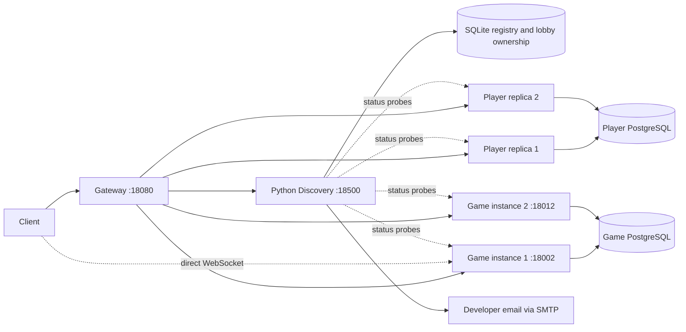

# Lab 3 — presentation and demonstration guide

This implementation covers **Islam's Player/Game and Maxim's Zombie/Resource services**, plus
the shared Python Gateway, new Python Service Discovery and deployment. Maxim's detailed
rubric mapping, concurrency explanation and live demonstration are in
[lab3-maxim-mentor-guide.md](lab3-maxim-mentor-guide.md). Exam, World, Base and Crafting remain
their owners' responsibility.

## 1. What to say first

> “Lab 2 had one address per service. Lab 3 runs two Player instances and two Game instances.
> Instances register themselves with Service Discovery. The Gateway obtains an eligible
> instance dynamically, distributes ordinary requests using round robin, and keeps each live
> game lobby on one owner. Discovery checks health and load, sends SMTP alerts, and removes an
> instance after three failures within 3.5 times its task timeout.”

Python is our **banned language**, so Discovery and Gateway use Python. Player and Game use Go.
This is horizontal scaling: more processes handle requests, rather than increasing one process's
CPU or memory. Replicas of a service share **that service's database**, never another service's.



## 2. Rubric checklist and evidence

| Grade | Requirement | Implementation / evidence |
| --- | --- | --- |
| 2 | Private Discovery repository, contributors, README and workflow | `PAD-TEAM-7/service-discovery`; invitations/access for `huntrese` and all four members; CPR submodule; README; GitHub Actions |
| 3 | Status endpoints and logs | Player and Game `GET /api/v1/status`; database readiness, instance, active requests, capacity and load; JSON request logs; Gateway and Discovery status and operational logs |
| 4 | Startup registration in banned language; DockerHub | Python Discovery `POST /v1/instances`; Go lifecycle renews every 5 s; Dockerfile and public versioned image |
| 5 | Two or three instances; dynamic membership | Two Player replicas and two explicit Game instances in `docker-compose.lab3.yml`; heartbeat leases and graceful deregistration |
| 6 | Round robin and correct stateful instance | Player rotation; ordinary Game requests rotate; persistent lobby affinity used by both REST and direct WebSocket negotiation |
| 7 | Three failures in task timeout × 3.5; caller circuit breakers | Gateway reports upstream failures; Game's outbound HTTP transport wraps every dependency call and JWKS fetch; local fallback breaker covers unregistered dependencies |
| 8 | Periodic health and critical-load alerts | Active database-aware status probe every 5 s; critical at `in_flight / capacity >= 0.8`; alert logs |
| 9 | Developer notifications | SMTP delivery, verified STARTTLS, per-alert cooldown and failure logging; real SMTP submission tested against a local receiver; configure actual developer mailbox before presentation |
| 10 | Remove failing service instance | Third unique failure removes the instance from eligible routing; removal survives heartbeats and Discovery restart; explicit health-checked restore |

The rubric is cumulative. A log line alone is not evidence of a delivered external email.
Show the developer inbox when demonstrating grade 9. Repository invitations must be accepted
by recipients; sending an invitation does not guarantee that acceptance.

## 3. Start the project

Run from the **CPR checkout containing the Lab 3 branch**. The deployment uses its own Compose
project and volumes, with ports distinct from the existing Lab 2 stack.

```powershell
cd team-cpr/deploy
# On a fresh checkout only:
Copy-Item .env.example .env
# Edit .env: replace placeholder passwords, shared secrets and DISCOVERY_TOKEN.
docker compose -f docker-compose.lab3.yml pull
docker compose -f docker-compose.lab3.yml up -d
docker compose -f docker-compose.lab3.yml ps
```

Do not overwrite an existing `.env`. `DISCOVERY_TOKEN` needs at least 32 random characters.
The real `.env` is ignored by Git. The default local demonstration addresses are:

| Component | Address |
| --- | --- |
| Gateway health | `http://localhost:18080/health` |
| Gateway API documentation | `http://localhost:18080/gateway/docs` |
| Discovery health | `http://localhost:18500/health` |
| Discovery API documentation | `http://localhost:18500/docs` |
| Player status through Gateway | `http://localhost:18080/player-service/api/v1/status` |
| Game status through Gateway | `http://localhost:18080/game-service/api/v1/status` |
| Game 1 direct WebSocket origin | `ws://localhost:18002` |
| Game 2 direct WebSocket origin | `ws://localhost:18012` |

Default images: `geografix/player-service:3.0.0`, `geografix/game-service:3.0.0`,
`geografix/pad-gateway:3.0.0`, `geografix/service-discovery:3.0.0`.
`LAB3_*_VERSION` variables pin them independently.
The extended deployment also uses `geografix/zombie-service:3.0.0` and
`geografix/resource-service:3.0.0`; see the Maxim guide for their demonstration.

For local source builds:

```powershell
docker compose -f docker-compose.lab3.yml -f docker-compose.lab3.build.yml build
docker compose -f docker-compose.lab3.yml up -d --pull never
```

On a memory-constrained machine, build the four images individually from the CPR root with
`docker build -t <image:tag> <service-directory>` before starting Compose. Game instances use
the same image; build it only once.

Game's optional `LAB3_*_SERVICE_URL` settings retain the existing dependency-mocking defaults.
The extended deployment runs real Zombie and Resource services, and Zombie calls the real
Player and Resource services through the Gateway. The dedicated Maxim smoke test exercises those
real interactions. Connect other integrations through reachable Gateway-prefixed addresses once
their contracts are ready. `localhost` inside a container refers to that container, not the host.

## 4. Ten-minute live demonstration

### Minute 0–2: architecture and registration

Show Compose's two Player containers and two Game containers. Show their registration logs:

```powershell
docker compose -f docker-compose.lab3.yml logs --tail 30 service-discovery
docker compose -f docker-compose.lab3.yml logs --tail 20 player-service game-service game-service-2
```

Load the registry token into a PowerShell variable without displaying its value:

```powershell
$tokenLine = Get-Content .env | Where-Object { $_ -match '^DISCOVERY_TOKEN=' } | Select-Object -Last 1
$discoveryHeaders = @{ Authorization = 'Bearer ' + $tokenLine.Substring('DISCOVERY_TOKEN='.Length).Trim() }
$registry = 'http://localhost:18500'
(Invoke-RestMethod "$registry/v1/instances" -Headers $discoveryHeaders).instances |
    Format-Table service, instance_id, healthy, lease_valid, removed
```

Explain: registration announces an address, an active probe establishes readiness, and a lease
prevents an old address remaining eligible forever after a crash. Health, lease and circuit state
are separate: an instance must pass all three conditions to be selected.

### Minute 2–4: round robin and shared state

```powershell
1..6 | ForEach-Object {
    $result = Invoke-WebRequest 'http://localhost:18080/player-service/api/v1/status' -UseBasicParsing
    $result.Headers['X-Service-Instance']
}
```

With two healthy Player replicas, expect `A, B, A, B, A, B`. Other concurrent traffic can advance
the cursor, so close unrelated load generators while demonstrating the exact sequence.

Run the reproducible end-to-end check from the CPR root:

```powershell
cd ..
python -u scripts/lab3-smoke.py
```

It registers a new demo player, logs in on another replica, reads the profile with the issued
token, rotates the refresh token and rejects its reuse. It also creates a lobby, checks repeated
requests stay on one Game owner, and checks that WebSocket negotiation returns that owner's
public address. It injects controlled failure reports, verifies removal survives a heartbeat,
and restores the instance in a `finally` block.

Explain the two startup fixes: all Player replicas share one RSA key volume, with atomic
publication so concurrent starts cannot create different keys; PostgreSQL advisory locks
serialize schema initialization. Refresh tokens and player state are in shared PostgreSQL.

### Minute 4–6: stateful Game routing

Explain why pure round robin is insufficient for live lobbies: WebSocket subscribers and action
timers are process-local. Discovery stores `service + lobby_id -> instance_id` persistently.
The Gateway uses the same key for REST paths and `/ws/v1/lobbies/{id}` negotiation.

Game has two explicit Compose services with stable IDs `game-1` and `game-2` and distinct public
WebSocket ports. This makes the negotiated address usable from the client. A single Docker DNS
name or one fixed published port would not identify the chosen process reliably.

The gateway negotiates the connection; it does not carry the WebSocket stream. Game still
validates the player token on upgrade. Actions/trades addressed only by ID use shared database
state. Action completion checks current persisted status before awarding a cancelled action.

### Minute 6–8: real HTTP failure and critical load

Run the extended demonstration:

```powershell
python -u scripts/lab3-smoke.py --fault-demo
```

The extended mode starts a temporary local HTTP fixture on port 19090, registers it as an extra
Player instance, reports critical load, and returns genuine HTTP 500 responses from different
endpoint paths. Requests travel through the real Gateway. After three failures, the fixture is
removed and later requests reach only healthy Player instances. The fixture is deregistered
and shut down at the end. Docker Desktop must be able to reach `host.docker.internal:19090`.

Say explicitly that this extra instance is a **fault-injection fixture**, not a real Player
implementation. The ordinary smoke checks before it run against the actual Go services.

With a 15-second task timeout, calculate `15 × 3.5 = 52.5 seconds`. The policy counts three
unique failures in that rolling window, across endpoints. A success does not reset a rolling
window. Client validation errors such as 400/401/404 are not server failures. Overload 429 is
handled by load alerts, not treated as evidence that an instance crashed.

### Minute 8–10: email, restoration and evidence

Before presentation, configure these in `deploy/.env`:

```dotenv
SMTP_HOST=your-provider-starttls-host
SMTP_PORT=587
SMTP_USERNAME=your-mail-account
SMTP_PASSWORD=your-provider-app-password
SMTP_STARTTLS=true
SMTP_FROM=your-mail-account
SMTP_TO=your-developer-email
```

Then recreate Discovery to load the changed environment:

```powershell
cd deploy
docker compose -f docker-compose.lab3.yml up -d --force-recreate service-discovery
```

Wait for renewed registrations, rerun the fault demo and show both `notification_sent` in logs
and the received email. The cooldown is 60 seconds per instance/alert type. A new fault fixture
gets a new identity on every demo run. SMTP port 465 implicit TLS is not supported: use STARTTLS.

For a manually removed real instance, restore only after fixing the underlying problem:

```powershell
# Replace the ID with the actual value from the registry listing.
Invoke-RestMethod "$registry/v1/instances/<instance-id>/restore" -Method Post -Headers $discoveryHeaders
```

Restoration performs a fresh health check and requires a live lease. Heartbeats alone cannot
clear quarantine. That distinction is the grade-10 behavior beyond merely logging a trip.

## 5. Dynamic scaling demonstration

From `deploy`:

```powershell
docker compose -f docker-compose.lab3.yml up -d --scale player-service=3
# Wait about 5–10 seconds, then inspect registry and repeat the routing requests.
docker compose -f docker-compose.lab3.yml up -d --scale player-service=2
```

Player has no fixed host port and derives its address/identity from its container hostname.
No Gateway restart or route edit is needed. Stopped instances deregister; abrupt crashes expire
or fail health probes. Historical rows can remain visible but are not eligible for routing.

Do not use `--scale game-service=3`: its fixed public WebSocket port would collide. Add a third
explicit Game instance with a stable unique ID, internal address, host port and public WS URL.
This is an intentional constraint of the direct-WebSocket design.

## 6. Likely mentor questions

**Why not round robin every Game request?** The lobby's live subscribers and timer belong to one
process. Persistent affinity preserves that relationship while distributing different lobbies.

**What happens when that Game process dies?** Its lobbies return 503 until the same stable instance
is repaired and restored. Clients must reconnect WebSockets. We do not claim transparent failover
or recovery of in-memory timers after a process restart. A durable job queue and distributed event
bus would be the next step for that stronger availability requirement.

**Why do two Player replicas accept the same JWT?** They share the RSA key volume. The Gateway
loads their public key via JWKS. Refresh-token consumption is atomic in PostgreSQL, so replay
cannot become valid by landing on another replica.

**What exactly is removed?** The failing instance is excluded from the eligible set. The process
is not deleted, and its database is not touched. Other instances remain routable. A permanent
service-wide outage returns 503 instead of falling back to an address known to be unsafe.

**Where is the circuit breaker?** Gateway reports every managed upstream server/transport failure
to Discovery, which maintains the rolling threshold and global quarantine. Game wraps outbound
HTTP calls, including its JWKS lookup, and reports selected-instance failures with the Gateway's
failure ID to avoid double counting. For unregistered external dependencies, Game locally opens
its per-dependency circuit for one window, then allows a recovery attempt. Player has no outbound
domain dependency calls; it performs discovery lifecycle calls and database operations.

**Is load CPU utilization?** No. It is active HTTP requests divided by the configured request
capacity. It measures application concurrency pressure. An 80% alert is independent of the
100% admission limit. Database readiness is checked separately in the same status endpoint.

**What survives a Discovery restart?** Registrations, quarantine and lobby ownership survive in
SQLite. The round-robin cursor and alert cooldown restart. Services renew leases automatically.
Run one Discovery worker; this lab does not implement a highly available control plane.

**Why return 503 when Discovery is down?** Managed services require authoritative selection.
Static fallback could resurrect a quarantined instance or send a live lobby to a different owner.

**How do retries interact with mutation?** The Gateway does not automatically replay failed writes.
Domain idempotency keys remain the caller's responsibility; a transport failure may happen after
the service committed a mutation. Circuit isolation and idempotency solve different problems.

**Does this finish the whole team's grade 10?** It implements Player, Game, Zombie, Resource
and their shared infrastructure. The remaining owners must integrate their own status,
registration and outbound callers. External email must be configured and demonstrated. The mentor assigns the grade.

## 7. Source tour

| File | What to explain |
| --- | --- |
| `service-discovery/app/main.py` | Registration, SQLite state, selection, rolling failures, monitor, SMTP |
| `gateway-service/app/discovery.py` | Selection API and lobby-key extraction |
| `gateway-service/app/proxy.py` | Dynamic destination, failure reporting, response instance metadata |
| `gateway-service/app/realtime.py` | Owner-specific direct WebSocket address |
| `gateway-service/app/auth.py` | JWKS also uses discovered Player instances |
| `game-service/internal/platform/discovery.go` | Lifecycle, load/status wrapper, outbound transport breaker |
| `player-service/internal/platform/discovery.go` | Lifecycle and status wrapper; same protocol implementation |
| `player-service/internal/player/auth.go` | Atomic shared signing-key publication |
| `deploy/docker-compose.lab3.yml` | Two replicas, private databases, stable Game IDs/ports, image tags |
| `scripts/lab3-smoke.py` | Repeatable live assertions and optional fault injection |

## 8. Verification and cleanup

Recorded verification details and release links belong in [lab3-verification.md](lab3-verification.md).
Local test commands within each private checkout:

```sh
# Player / Game, Go 1.24
go test -race ./...
# Gateway / Discovery, Python 3.12+
pip install -r requirements-dev.txt
ruff check .
ruff format --check .
python -m pytest -q
```

Stop just this lab with `docker compose -f docker-compose.lab3.yml down`. Named volumes remain.
Avoid `down -v` unless you deliberately want to erase the demo databases, shared signing key and
registry. Nothing in the demo requires deleting your Lab 2 data.

Changes are published on review branches/PRs because existing protected branches require two
reviews. A visible PR is not the same as a merged release. Use the Lab 3 branch when presenting
until the team completes its required reviews and merges.
